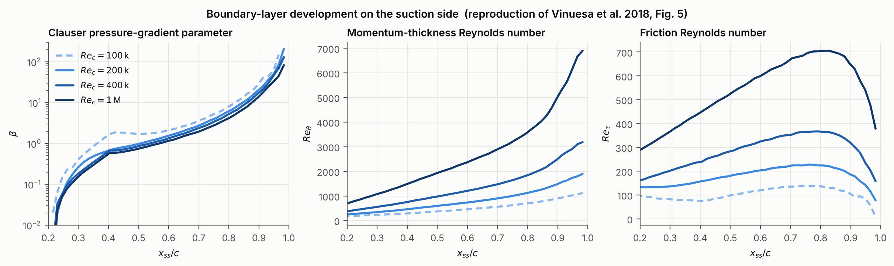

# Pressure-gradient turbulent boundary layers: a reproduction and a methods audit

A full reproduction of the wing boundary-layer results of
[Vinuesa et al. (2018)](#references), an audit of two VinuesaLab databases,
and an assessment of what data-driven models can and cannot extract from
data of this size.

**This repository makes no new claim about turbulence physics.** The
physical effects it touches were established by the papers listed under
[relation to prior work](#relation-to-prior-work). What is here is a
reproducible pipeline, two documented traps in the data, and a set of
identifiability results that bear on anyone fitting history models to
boundary-layer databases.

---

## 1. Reproduction



Every quantity tabulated in Vinuesa et al. (2018), Tables 3 and 4 plus
the maxima quoted in its Section 3.1, recomputed from the distributed
database and interpolated to the exact chordwise stations the paper quotes:

| | |
|---|---|
| quantities compared | **48** |
| median absolute error | **0.75%** |
| within 2% | **38 / 48** |
| within 5% | **47 / 48** |

Recovered maxima of `Re_tau` are 140, 230, 365 and 707 against the
published 139, 231, 366 and 707. The residual is dominated by `beta` being
published to two significant figures.

```bash
python scripts/reproduce_paper.py   # figures + report
python -m pytest tests/ -q          # 64 tests
```

Full table: [`paper/reproduction_report.md`](paper/reproduction_report.md).
Pinned as regression tests in [`tests/test_reproduction.py`](tests/test_reproduction.py).

## 2. Two traps in the distributed data

Neither is documented in the distributions, and both are easy to get wrong.

**The WING database scales on `max(U)`, not on its `Ue` field.** Every
shipped integral quantity (`Cf`, `Re_delta*`, `Re_theta`, `delta*`,
`theta`) is built on the peak tangential velocity of each profile.
Verified by inverting each quantity for the velocity it implies: agreement
with `max(U)` to machine precision across all nine cases. Using the `Ue`
field instead, which is the obvious reading, puts the integral thicknesses
out by **9–13%** and `Cf` by about **6%**.

**The APG database does the opposite.** There, every shipped quantity *is*
built on the `Ue` field, verified the same way to six decimals across all
five cases. Two databases from one group, in one file format, with opposite
conventions.

Both are documented with the evidence in
[`docs/DATA_NOTES.md`](docs/DATA_NOTES.md), which also records that `beta`
cannot be recomputed from the 50 stored wing stations to better than ~7%,
and that the pressure-side TKE budgets ship empty.

## 3. How closely is `beta` matched between the wing cases?


Vinuesa et al. (2018) compare four Reynolds numbers at *approximately* the
same `beta(x)`; their abstract says so explicitly. This quantifies how
approximate. Over `0.25 <= x/c <= 0.95`:

| comparison | mean ratio | range |
|---|---|---|
| `beta(200k) / beta(1M)` | **1.42** | 1.17 – 1.74 |
| `beta(400k) / beta(1M)` | **1.19** | 1.14 – 1.43 |

with `beta` decreasing monotonically with `Re_c` at every station. The
source's own Table 4 is consistent (2.6, 2.4, 2.0 at `x/c` = 0.7). The
spread is hard to see in the original Fig. 5 because `beta` is plotted on a
four-decade logarithmic axis, where a factor of 1.4 is a hairline.

## 4. A three-term model, and what it can't tell you

The model fitted here is

> **y = C · β^a₁ · exp(a₂Λ) · Re_τ^a₃**,  with  **Λ = (δ₉₉/β)·dβ/dx**

Under leave-one-Reynolds-number-out validation it predicts a held-out
Reynolds number to **1.0–7.7%**, and transfers from the NACA4412 at 5° to
the NACA0012 at 0° at **2.5–9.8%** on five of six quantities. Λ removes
**73–91%** of the wing's error and essentially nothing on five
near-equilibrium flat-plate layers, where local variables already suffice
to 1–5%.

**What the model does not establish.** An earlier version of this work
decomposed the difference between Reynolds-number cases into
pressure-gradient and Reynolds-number shares and quoted percentages. Those
percentages are not reported here any more, for two reasons given by
R. Vinuesa in review and confirmed on inspection:

- The design matrix has a condition number of **18–57**. With three
  correlated predictors across three cases, the coefficient split is not
  identified, so a regression decomposition does not establish independent
  physical contributions.
- The "pressure gradient" share combined the `beta` and `Λ` terms, so it
  could not be attributed to the `beta` mismatch specifically.

The field's own approach to this separation is sounder: use constant-`beta`
configurations so the parameters are decoupled by construction rather than
by regression. See Sanmiguel Vila et al. (2020) and Pozuelo et al. (2022).

## 5. Identifiability: what this data can and cannot support

These are the findings that motivated the audit, and the reason the
decomposition above was withdrawn.

**A memory length below the station spacing cannot be fitted.** A kernel of
0.5 δ₉₉ is **0.47 station spacings** on the 50-station wing grid: it decays
inside a single quadrature panel, `beta_bar` collapses onto the local
`beta`, and the feature degenerates into a finite-difference gradient. On
the 1570-station flat plates the same length spans 4–20 spacings. Any
memory length fitted to the wing data is a property of the grid.

**Length and coefficient trade off.** On synthetic data the fitter recovers
all four parameters to four significant figures. Adding 0.2% noise in log
space, far below the scatter in the LES statistics, moves the fitted
length by **15–27%** and its coefficient by up to **65%**, because a
shorter memory shrinks `log(beta_bar/beta)` and a larger coefficient
compensates.

**Model selection on this much data is badly optimistic.** Choosing among
~1000 candidate expressions by leave-one-Reynolds-number-out understates
true held-out error by a **median factor of 4.4**, reaching 5.9. Scored on
the unseen NACA0012, the searched expressions beat the simple three-term
law on only four of six targets.

None of this is novel as statistics; identifiability and selection bias are
standard. It is recorded because the specific numbers are useful to anyone
fitting history models to databases of this size.

## Relation to prior work

The physical effects this repository touches were established elsewhere,
and the following should be read before the results above:

- **Bobke et al. (2017)** established the importance of pressure-gradient
  history and showed that local parameters alone do not characterise an APG
  boundary layer.
- **Tanarro et al. (2020)** assesses history on the same two wing
  geometries using an integrated Clauser parameter, and concludes that
  history governs the outer region while the near-wall peak follows the
  local APG magnitude.
- **Schlatter et al.** compare constant-`beta` and non-constant-`beta`
  cases at matched `beta` and `Re_tau` on the same flat-plate database.
  Comparing boundary layers at matched `beta` and `Re_tau` and finding the
  outer-layer stresses still differ is their result, not a new one.
- **Sanmiguel Vila et al. (2020)** addresses the separation of APG and
  Reynolds-number effects directly, using datasets in which the two are
  varied independently.
- **Vinuesa et al. (2017)** introduced the integrated Clauser parameter as
  a history measure.

An earlier draft of this work presented several of these as new findings.
That was a failure of literature review on my part, corrected here.

## Install

```bash
pip install -e ".[dev]"
```

## Data

Neither database is redistributed here. The download links published on
`vinuesalab.com` point at a personal KTH OneDrive account that is no longer
served; both files were supplied on request by R. Vinuesa, whom I thank.
Place `naca4412.mat`, `naca0012.mat` and `apg.mat` in `data/raw/`.

```python
from wingtbl.loader import load_wing
from wingtbl.apg_loader import load_apg

wing = load_wing("data/raw/naca4412.mat")   # 8 cases, 50 stations each
apg  = load_apg("data/raw/apg.mat")         # 5 histories, 1570 stations each
wing["top10n"].Re_tau.max()
```

Each case is an `xarray.Dataset` over `(station, j)` carrying the mean flow,
the Reynolds-stress tensor, the TKE budget terms and the shipped integral
quantities, in the local tangential / wall-normal frame, with the correct
velocity scale for its database already applied.

## Layout

```
wingtbl/        loaders for both databases, BL quantities, model, validation
scripts/        reproduction, audit, model fitting, figures
tests/          64 tests, including regression against the published values
docs/           DATA_NOTES.md, the provenance audit
paper/          figures, generated tables, and an unpublished draft
```

`paper/wing_memory.tex` is a draft that was **not** submitted; its framing
overstates novelty for the reasons in [relation to prior
work](#relation-to-prior-work). It is kept for the figures and the record.

## References

1. R. Vinuesa, P. S. Negi, M. Atzori, A. Hanifi, D. S. Henningson and
   P. Schlatter. Turbulent boundary layers around wing sections up to
   `Re_c` = 1,000,000. *Int. J. Heat Fluid Flow* **72**, 86–99 (2018).
2. Á. Tanarro, R. Vinuesa and P. Schlatter. Effect of adverse pressure
   gradients on turbulent wing boundary layers. *J. Fluid Mech.* **883**,
   A8 (2020).
3. A. Bobke, R. Vinuesa, R. Örlü and P. Schlatter. History effects and near
   equilibrium in adverse-pressure-gradient turbulent boundary layers.
   *J. Fluid Mech.* **820**, 667–692 (2017).
4. C. Sanmiguel Vila, R. Vinuesa, S. Discetti, A. Ianiro, P. Schlatter and
   R. Örlü. Separating adverse-pressure-gradient and Reynolds-number
   effects in turbulent boundary layers. *Phys. Rev. Fluids* **5**, 064609
   (2020).
5. R. Vinuesa, R. Örlü, C. Sanmiguel Vila, A. Ianiro, S. Discetti and
   P. Schlatter. Revisiting history effects in adverse-pressure-gradient
   turbulent boundary layers. *Flow Turbul. Combust.* **99** (2017).
6. R. Pozuelo, Q. Li, P. Schlatter and R. Vinuesa. An adverse-pressure-
   gradient turbulent boundary layer with nearly constant β ≃ 1.4 up to
   Re_θ ≃ 8700. *J. Fluid Mech.* **939**, A34 (2022).
7. R. Deshpande, A. Bogaard, R. Vinuesa, L. Lindic and I. Marusic.
   Reynolds-number effects on the outer region of adverse-pressure-gradient
   turbulent boundary layers. *Phys. Rev. Fluids* **8**, 124604 (2023).
8. R. Vinuesa, A. Bobke, R. Örlü and P. Schlatter. On determining
   characteristic length scales in pressure-gradient turbulent boundary
   layers. *Phys. Fluids* **28**, 055101 (2016).

## Acknowledgements

R. Vinuesa supplied both databases and reviewed an early draft in detail.
The corrections in sections 4 and 5, and the relation-to-prior-work section,
follow directly from that review.

## Licence

MIT for the code. The databases are the property of their authors and are
not redistributed; cite references 1–3 when using them.
