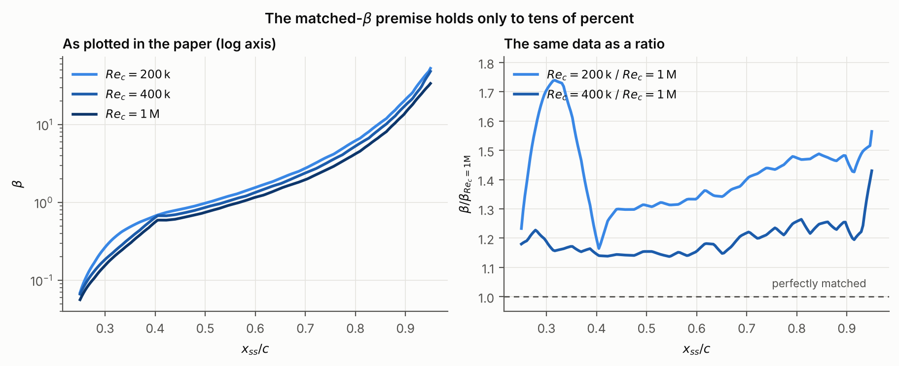
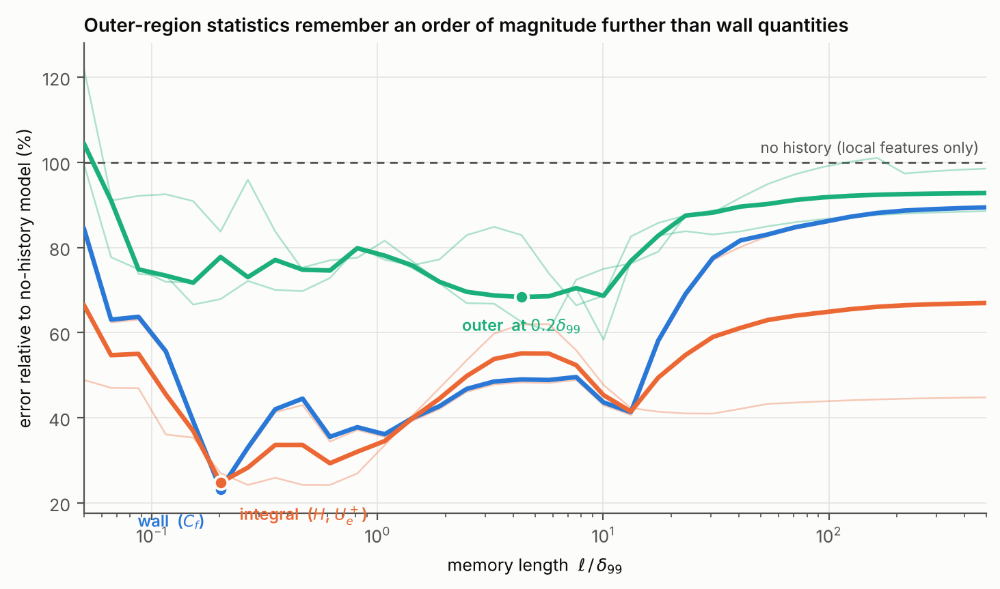
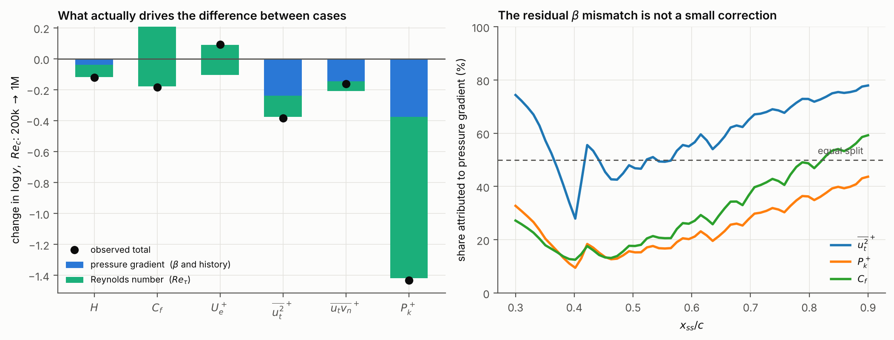
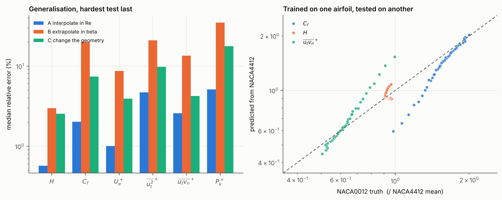
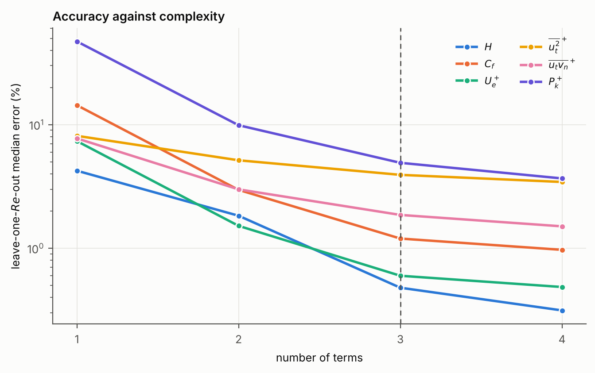

# wing-memory

**Separating local pressure gradient, flow history and Reynolds number in
turbulent wing boundary layers.**

Built on the VinuesaLab WING database: well-resolved LES of the turbulent
boundary layers around a NACA4412 wing section at `Re_c` = 100k, 200k, 400k
and 1M (5° angle of attack), plus a NACA0012 at `Re_c` = 400k.

---

## Status

| phase | state |
|---|---|
| 0. Loader, boundary-layer quantities, reproduction of the paper | **done** |
| 1. Baselines, memory kernel, leakage-safe validation | **done** |
| 2. Fitted memory length + exact decomposition into β / history / Re | **done** |
| 3. Cross-geometry generalisation + symbolic search | **done** |
| 4. Write-up; more cases if the Mallor (2024) database becomes available | next |

## Phase 0 result: the published results come back out of the published files


Every quantity tabulated in Vinuesa et al. (2018), recomputed from the
distributed data and interpolated to the exact chordwise stations the paper
quotes:

| | |
|---|---|
| quantities compared | **48** |
| median absolute error | **0.75%** |
| mean absolute error | **1.24%** |
| within 2% | **38 / 48** |
| within 5% | **47 / 48** |

The residual is dominated by the paper quoting `beta` to two significant
figures. Full table: [`paper/reproduction_report.md`](paper/reproduction_report.md).
Pinned as regression tests in [`tests/test_reproduction.py`](tests/test_reproduction.py).

```bash
python scripts/reproduce_paper.py      # figures + report
python -m pytest tests/ -q             # 31 tests
```

## Two findings from the audit

### 1. The velocity scale is `max(U)`, not the `Ue` field

Every shipped integral quantity — `Cf`, `Re_delta*`, `Re_theta`, `delta*`,
`theta` — is built on the peak tangential velocity of each profile, not on
the `Ue` field stored alongside it. Verified exactly, across all nine cases,
by inverting each quantity for the velocity it implies.

Using `Ue` instead, which is the obvious reading of the files, puts the
thicknesses out by **9–13%** and `Cf` by about **6%**. `wingtbl` exposes the
correct scale as `U_ref`.

### 2. The matched-`beta` premise holds only to tens of percent



The paper's design holds the pressure-gradient history fixed and varies the
Reynolds number, describing the `Re_c >= 200k` cases as seeing
"approximately the same" `beta(x)` with differences "on the order of 10%"
only beyond `x/c > 0.9`. Over the analysis window `0.25 <= x/c <= 0.95` the
data gives:

| comparison | mean ratio | range |
|---|---|---|
| `beta(200k) / beta(1M)` | **1.42** | 1.17 – 1.74 |
| `beta(400k) / beta(1M)` | **1.19** | 1.14 – 1.43 |

with `beta` decreasing monotonically with `Re_c` at every station. The
paper's own Table 4 shows the same (2.6 / 2.4 / 2.0 at `x/c` = 0.7). The
apparent collapse is an artefact of a four-decade log axis.

This matters because the paper's headline result — that the wing-to-ZPG
ratios all decrease with `Re_c`, so low-Re boundary layers are more sensitive
to a given pressure gradient — rests on `beta` being matched. It is not, and
`beta` moves in the *same* direction as the effect being measured. The two
causes are confounded.

**That confound is what this project sets out to resolve**, by fitting a
model whose terms are the local pressure gradient, its upstream history and
the Reynolds number, and reporting how the measured sensitivity divides
between them.

Both findings are documented in full, with the evidence, in
[`docs/DATA_NOTES.md`](docs/DATA_NOTES.md).

## Phase 1 result: the boundary layer remembers, and how far depends on where you look



Each station is described by local variables (β, Re_τ, u_p/U_e, dβ/dx) and
optionally by a **history** variable: β convolved with a decaying kernel
whose memory length ℓ is swept. Scored by **leave-one-Reynolds-number-out**
validation — the model must predict a Reynolds number it has never seen —
with W1 excluded as not a well-behaved TBL.

Adding history reduces error on every target:

| target | local only | + history | reduction |
|---|---|---|---|
| `Cf` | 3.7% | 2.3% | 36% |
| `H` | 1.2% | 0.5% | 59% |
| `Ue_plus` | 1.9% | 1.2% | 37% |
| `uu_outer` | 8.6% | 7.5% | 13% |
| `uv_outer` | 4.5% | 3.7% | 18% |
| `Pk_outer` | 9.8% | 8.2% | 16% |

*(median relative error, ridge in log space; the same comparison in a
gradient-boosting family gives 0–72% reductions)*

**Controlled against a placebo.** Three random features of the same
dimensionality change the error by −10% to +16% — mostly making it worse. The
history gain is not just extra flexibility.

**A claim from this scan that did *not* survive Phase 2.** Sweeping ℓ and
taking the per-target optimum appeared to separate the regions by an order
of magnitude — ℓ ≈ 0.2δ₉₉ for wall quantities against 5.7–10δ₉₉ for
outer-region ones — which would have been Clauser's long-memory remark
turned into a number. It does not hold up. That scan chose ℓ by *held-out*
error, which is selection on the test set, and it used a collinear feature
set. Repeating it with the memory length fitted inside each training fold
puts every target at ℓ ≈ 0.4–0.6δ₉₉ (below). The scan figure is kept because
the curves are genuinely informative about how much history matters; its
argmin is not.

```bash
python scripts/phase1_baselines.py   # the model ladder + placebo control
python scripts/memory_scan.py        # the memory-length sweep
```

Full tables: [`paper/phase1_results.md`](paper/phase1_results.md),
[`paper/memory_scan.md`](paper/memory_scan.md).

## Phase 2 result: most of the "Reynolds-number effect" in the outer region is the β mismatch



Phase 2 fits the smallest law that can answer the question,

> **y = C · β^a₁ · (β̄/β)^a₂ · Re_τ^a₃**

with the memory length ℓ of the kernel behind β̄ **fitted inside each
training fold**, then scored on a held-out Reynolds number. Three terms, one
length — about as much as ~40 stations per case can support.

| target | ℓ / δ₉₉ (fold range) | held-out error |
|---|---|---|
| `H` | 0.59 (0.57 – 0.70) | 1.15% |
| `Cf` | 0.43 (0.41 – 0.48) | 2.36% |
| `Ue_plus` | 0.43 (0.41 – 0.48) | 1.20% |
| `uu_outer` | 0.46 (0.46 – 0.60) | 9.24% |
| `uv_outer` | 0.45 (0.41 – 0.52) | 3.82% |
| `Pk_outer` | 0.47 (0.46 – 0.58) | 6.08% |

The memory length is short and stable across folds for every target, and the
inner objective is sharply peaked — error rises 10–24× as ℓ→0, where the
history term switches off, and 5–10× by ℓ = 17δ₉₉. History matters a great
deal; it just does not reach as far as Phase 1 suggested.

### The decomposition

Because the law is linear in log space, the difference between two cases at
matched chordwise position splits **exactly**:

```
Δlog y  =  a₁ Δlog β  +  a₂ Δlog(β̄/β)  +  a₃ Δlog Re_τ
           └──────── pressure gradient ────────┘   └─ Reynolds ─┘
```

Vinuesa et al. read that whole difference as a Reynolds-number effect, on
the premise that β is matched. It is not. Splitting it:

| target | pressure gradient | Reynolds number |
|---|---|---|
| `uv_outer` | **77%** | 23% |
| `uu_outer` | **64%** | 36% |
| `Cf` | 35% | **65%** |
| `H` | 34% | **66%** |
| `Ue_plus` | 35% | **65%** |
| `Pk_outer` | 27% | **73%** |

**For the outer-region Reynolds stresses, most of the apparent
Reynolds-number trend is the residual β mismatch** — the quantities the paper
leans on hardest for its conclusion that low-Re boundary layers are more
sensitive to a pressure gradient. For the wall and integral quantities, and
for TKE production, Reynolds number really does dominate and the original
reading stands.

Checked three ways: the shares move by ≤3 points when the comparison is
`W4→W10` instead of `W2→W10`; by ≤7 points when ℓ is forced to half or
double its fitted value; and the fitted law reproduces the observed change
to within 2–10%.

```bash
python scripts/phase2_decomposition.py
```

Full tables: [`paper/phase2_results.md`](paper/phase2_results.md).

### A limitation worth stating plainly

The memory length ℓ and the history exponent a₂ **trade off against each
other**: a shorter memory shrinks log(β̄/β), and a larger |a₂| compensates
almost exactly. On synthetic data the fitter recovers both to four
significant figures with no noise, but 0.2% noise in log space — far below
the scatter in the LES statistics — moves ℓ by 15–27% and a₂ by up to 65%.

So ℓ ≈ 0.5δ₉₉ is good to a factor of roughly 1.3, not to two digits, and is
reported that way. The decomposition is built from the *product* a₂·log(β̄/β),
in which the trade-off cancels — which is why the split above is stable while
its ingredients individually are not. Both facts are pinned in
[`tests/test_memory_model.py`](tests/test_memory_model.py).

## Phase 3 result: it transfers to another airfoil, and history multiplies with β



Every earlier conclusion rested on three Reynolds numbers of one wing. Three
tests, in increasing order of what they ask:

| target | A: hold out Re_c=400k | B: extrapolate β, 2.5 → 49 | **C: NACA4412 → NACA0012** |
|---|---|---|---|
| `H` | 0.57% | 2.99% | **2.54%** |
| `Cf` | 2.03% | 19.96% | **7.42%** |
| `Ue_plus` | 1.01% | 8.70% | **3.93%** |
| `uu_outer` | 4.72% | 20.96% | **9.81%** |
| `uv_outer` | 2.59% | 13.54% | **4.24%** |
| `Pk_outer` | 5.11% | 34.98% | **17.72%** |

Test **C** is the real one: fitted on a cambered section at 5° with β
reaching 46, then asked about a *symmetric* section at 0° where β only
reaches 3.3. Nothing about that geometry is in the training distribution
except the physics the law is meant to have captured, and most quantities
come back within 2.5–10%.

Test **B** is the honest limitation: extrapolating the power law twenty-fold
beyond its fitted β range costs 20–35% on `Cf`, `uu` and `Pk`. The law
should be used inside its calibration range.

**A fourth test is impossible, and the reason is a result.** The pressure
side is a *favourable* gradient with β < 0 at 88–95% of stations, and a law
containing β^a has no real value there. This is an adverse-pressure-gradient
law; it does not continue through β = 0.

### Does a richer expression beat the power law?



An exhaustive search over all 255 expressions of up to four terms from a
nine-term library, at four memory lengths — exhaustive rather than genetic,
so there is no seed, population size or stopping rule to defend, and the
result is optimal within the space.

Two findings, one encouraging and one cautionary.

**One term is chosen for every single target: `log β · log m`.** Out of nine
candidates and six independent selections. Its meaning is that the exponent
on β depends on how far the upstream history departs from the local value —
**history and local pressure gradient are not separable factors, they
multiply**. The Phase 2 law treats them as independent, which is why a fourth
term helps. Runners-up are `log²β` (5/6, curvature in β) and `log β · log R`
(4/6, a Reynolds-dependent β exponent).

**Selection optimism is 4.4× median.** The leave-one-Re-out error used to
pick an expression understates its true held-out error by a factor of 3–6.
Scored honestly on the NACA0012, the searched four-term expressions beat the
three-term power law on only 4 of 6 targets:

| target | searched, selection | searched, NACA0012 | power law, NACA0012 |
|---|---|---|---|
| `H` | 0.31% | **1.77%** | 2.18% |
| `Cf` | 0.97% | **4.24%** | 7.92% |
| `Ue_plus` | 0.49% | **2.19%** | 4.21% |
| `uv_outer` | 1.50% | **0.86%** | 4.26% |
| `uu_outer` | 3.44% | 11.09% | **9.74%** |
| `Pk_outer` | 3.67% | 21.77% | **18.47%** |

Anyone running symbolic regression on a turbulence dataset this size should
expect that gap. The Pareto curves also show a clear elbow at three terms:
the first three buy an order of magnitude, the fourth buys very little.

```bash
python scripts/phase3_generalisation.py
python scripts/phase3_symbolic.py
```

Full tables: [`paper/phase3_generalisation.md`](paper/phase3_generalisation.md),
[`paper/phase3_symbolic.md`](paper/phase3_symbolic.md).

### A methodological note worth repeating

Under leave-one-Reynolds-number-out, **ridge regression in log space beats
gradient boosting on every target** — often by a factor of three. With 120
stations across three cases, and a held-out fold that requires
*extrapolating* in Re_τ rather than interpolating, trees cannot leave the
range they were trained on. The small-data regime rewards the model that can
express a power law, which is also the form Phase 3 will try to recover
symbolically.

## Install

```bash
pip install -e ".[dev]"
```

## Data

The download links on `vinuesalab.com/wing/` point at a personal KTH OneDrive
account that is no longer served. The files were supplied directly by the
author on request (November 2026); contact rvinuesa@umich.edu. Place
`naca4412.mat` and `naca0012.mat` in `data/raw/`. The data is not
redistributed here.

```python
from wingtbl.loader import load_wing, concat_cases

cases = load_wing("data/raw/naca4412.mat")
suction = concat_cases([cases[k] for k in ("top1n", "top2n", "top4n", "top10n")])
suction.Re_tau.sel(case="W10").max()
```

Each case is an `xarray.Dataset` over `(station, j)` — 50 chordwise stations,
52 wall-normal points — carrying the mean flow, the Reynolds-stress tensor,
the TKE budget terms and the shipped integral quantities, all in the local
tangential / wall-normal frame.

## Layout

```
wingtbl/        loader, boundary-layer quantities, plotting style
scripts/        reproduce_paper.py, beta_confound.py
tests/          regression tests against the published values
docs/           DATA_NOTES.md -- provenance audit
paper/          figures and the reproduction report
```

## Caveats carried forward

- **W1** (`Re_c` = 100k) is not a well-behaved TBL and its last station has
  separated. Out-of-distribution test case only, never training data.
- **W10** ran at coarser resolution; the paper notes a slightly
  over-predicted near-wall `u_t^2` peak.
- **`beta` is used as shipped.** It cannot be recomputed from the 50 stored
  stations to better than ~7%, because they under-resolve `dPe/dx`.
- The pressure-side TKE budgets are empty in the distributed file.

## References

1. R. Vinuesa, P. S. Negi, M. Atzori, A. Hanifi, D. S. Henningson and
   P. Schlatter. Turbulent boundary layers around wing sections up to
   `Re_c` = 1,000,000. *Int. J. Heat Fluid Flow* **72**, 86–99 (2018).
2. A. Tanarro, R. Vinuesa and P. Schlatter. Effect of adverse pressure
   gradients on turbulent wing boundary layers. *J. Fluid Mech.* **883**,
   A8 (2020).
3. A. Bobke, R. Vinuesa, R. Örlü and P. Schlatter. History effects and near
   equilibrium in adverse-pressure-gradient turbulent boundary layers.
   *J. Fluid Mech.* **820**, 667–692 (2017).
4. R. Vinuesa, A. Bobke, R. Örlü and P. Schlatter. On determining
   characteristic length scales in pressure-gradient turbulent boundary
   layers. *Phys. Fluids* **28**, 055101 (2016).
5. P. Schlatter and R. Örlü. Assessment of direct numerical simulation data
   of turbulent boundary layers. *J. Fluid Mech.* **659**, 116–126 (2010).

## Licence

MIT for the code. The WING database is the property of its authors and is
not redistributed here; cite references 1 and 2 when using it.
